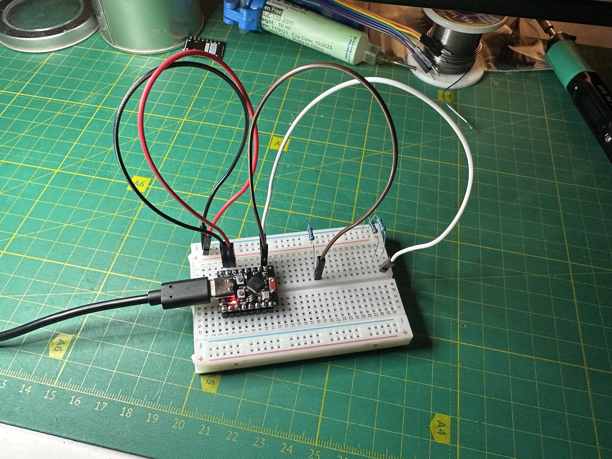

# Lab 001 — Voltage Divider & ADC

**Date:** 2026-11-24  
**Hardware:** ESP32-C3 SuperMini, breadboard, multimeter  
**Setup:** 3.3V → 10kΩ → GPIO0 → ID resistor → GND

| ID resistor  | Expected |               Measured (ADC) | Raw ADC |
| ------------ | -------: | ---------------------------: | ------: |
| 1kΩ          |   300 mV |                  ~300-306 mV |    ~408 |
| 2.2kΩ        |   595 mV |                  ~590-615 mV |    ~810 |
| Disconnected |    3.3 V | Saturated (2915 mV reported) |    4095 |

## Findings

- Voltage divider calculations match real measurements.
- Pull-up holds GPIO0 HIGH when the ID resistor is disconnected.
- ADC readings fluctuate slightly.
- `analogRead()` and `analogReadMilliVolts()` perform separate measurements.
- USB CDC logging works through PlatformIO Serial Monitor.

## Next

**Lab 002:** Add a 100 nF capacitor between GPIO0 and GND. Compare ADC stability before and after.
