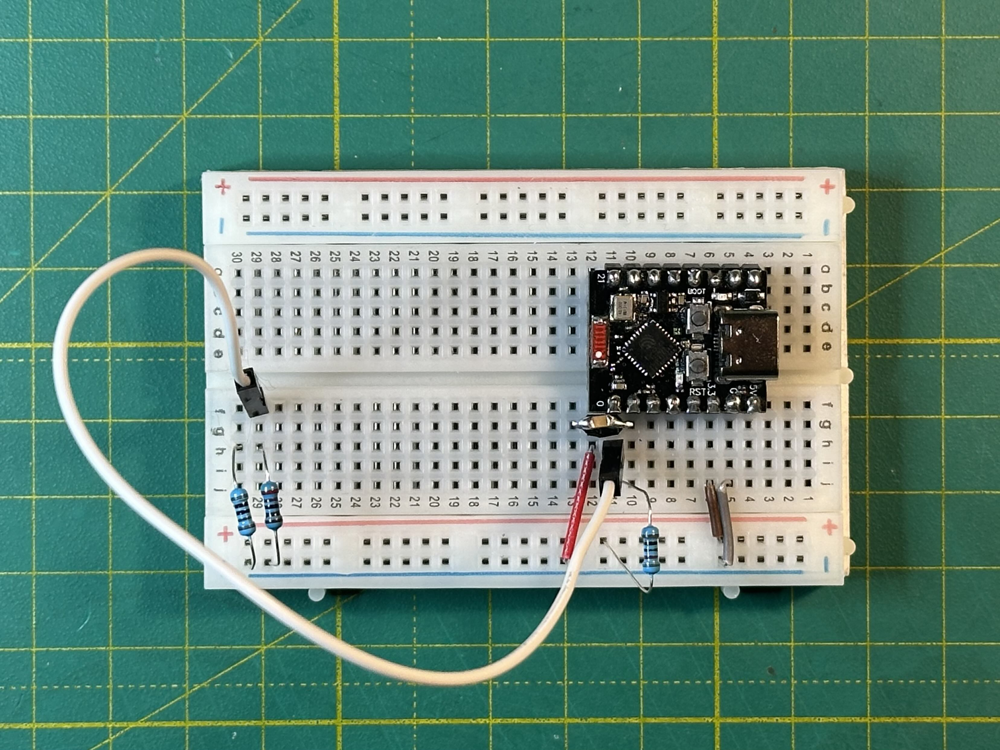

# Lab 002 — Capacitor & ADC Stability

**Date:** 2026-11-25  
**Hardware:** ESP32-C3 SuperMini, breadboard, multimeter, 100 nF ceramic capacitor  
**Setup:** 3.3V → 10kΩ → GPIO0 → ID resistor → GND; capacitor between GPIO0 and GND, in parallel with the ID resistor.

## Method

- Sample GPIO0 using `analogReadMilliVolts()` (12-bit ADC, 11 dB attenuation).
- Collect batches of 100 readings; report MIN, MAX, AVG, P2P, variance and standard deviation (STD).
- Compare with and without the capacitor using the same ID resistor and firmware.

## Results

Final control experiment with a 2.2kΩ ID resistor and improved jumper connections:

| Capacitor | Samples | Mean P2P | Mean STD |
|---|---:|---:|---:|
| 100 nF (first run) | 2900 | 22.62 mV | 2.38 mV |
| Disconnected | 2300 | 84.87 mV | 8.60 mV |
| 100 nF (repeat) | 2400 | 19.38 mV | 1.96 mV |

Additional experiment with both ID resistors:

| ID resistor | Samples (with / without C) | Mean P2P (with / without C) | Mean STD (with / without C) |
|---|---:|---:|---:|
| 1kΩ | 1100 / 1000 | 33.64 / 71.50 mV | 3.61 / 8.50 mV |
| 2.2kΩ | 1300 / 1600 | 21.85 / 102.06 mV | 2.18 / 11.15 mV |

Metrics are averages of per-batch statistics, not pooled standard deviations. Saturated readings (2915 mV) when the ID resistor was disconnected were excluded from noise comparisons. Batches immediately after resistor changes were retained.

## Findings

- In the control experiment, the capacitor reduced mean P2P by 75.1% and mean STD by 74.6% (both capacitor runs combined, weighted by batch count).
- The steady-state ADC voltage remained approximately 305 mV (1kΩ) or 605 mV (2.2kΩ).
- One soldered SMD capacitor developed a confirmed short circuit and was replaced. Early measurements also showed inconsistent filtering; after improving jumper connections, the expected effect became repeatable. The exact cause of the earlier noise anomaly was not isolated.
- Short, reliable GPIO0 and GND connections matter for repeatable ADC measurements.
- Without an ID resistor, the pull-up drives GPIO0 toward 3.3 V; the ADC saturates at a reported 2915 mV. This is a valid disconnected state, not evidence of zero noise.

## Next

**Lab 003:** RC Filter & Time Constant — measure capacitor charging and discharging and compare the measured response with theory.
